<div align="center">

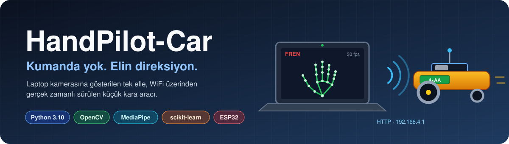


<br>


[Hareketler](#2-hareket-seti-v5-) · [Mimari](#4-sistem-mimarisi) · [Veri seti](#9-veri-seti) · [Donanım](#12-araç-tarafı-firmware-ve-donanım) · [Kurulum](#14-kurulum-ve-çalıştırma) · [İstatistikler](#24-sayılarla-handpilot-car) · [Şablonlar](#25-şablonlar) · [Lisans](#26-lisans)

</div>

> [!IMPORTANT]
> **Bu README projenin mihenk taşıdır.** Mimari, hareket seti, protokol, sayılar ve kurallar burada tanımlanır.
> `EL_KITABI.md` / `.docx` / sunum ile çelişki olursa **README geçerlidir**.
> README'deki **kilitli** (🔒) bir maddeyi değiştirmek için Furkan onayı + [Değişiklik Geçmişi](#23-değişiklik-geçmişi)'ne kayıt şarttır.

### Görsel özet

<table>
<tr>
<td width="50%">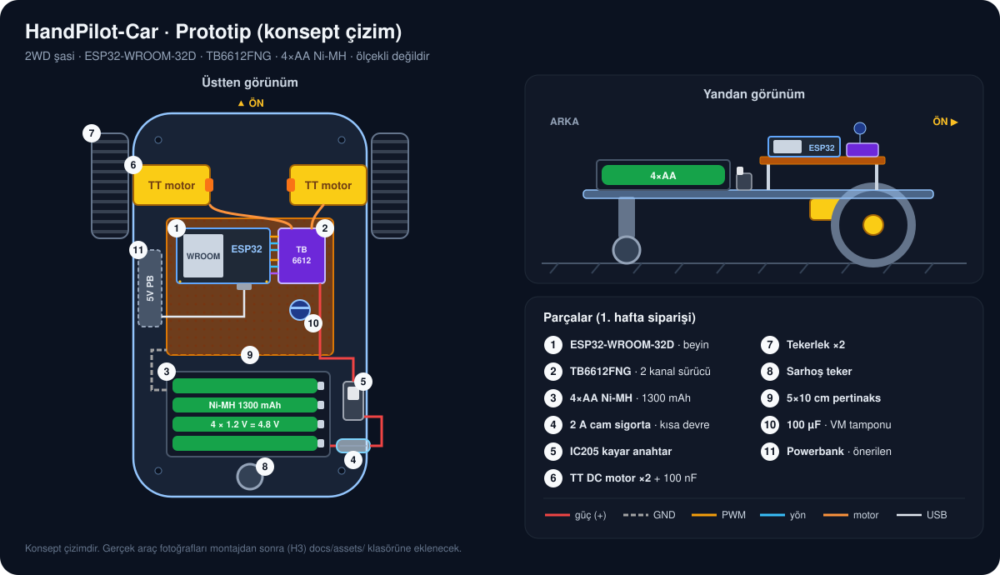<br><sub><b>Prototip araç</b> · konsept çizim (§12)</sub></td>
<td width="50%">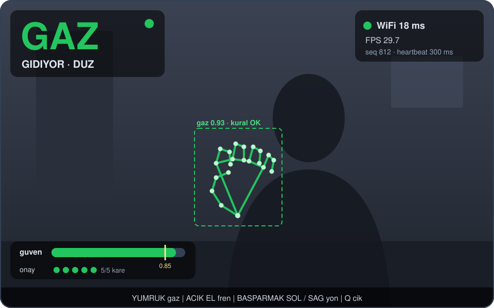<br><sub><b>Sürüş ekranı</b> · arayüz taslağı (FR-13)</sub></td>
</tr>
<tr>
<td width="50%">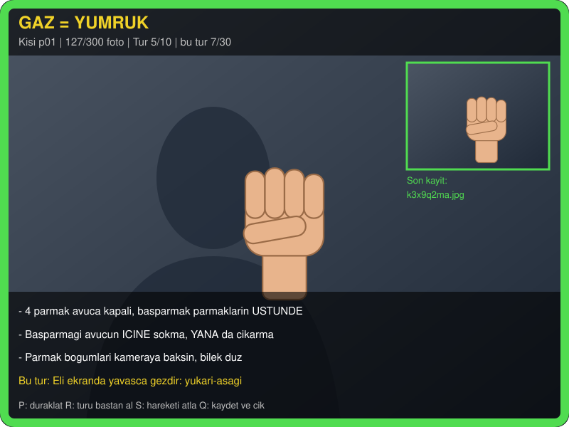<br><sub><b>Veri toplama</b> · <code>veri_topla.py</code> ekranı (§9.3)</sub></td>
<td width="50%">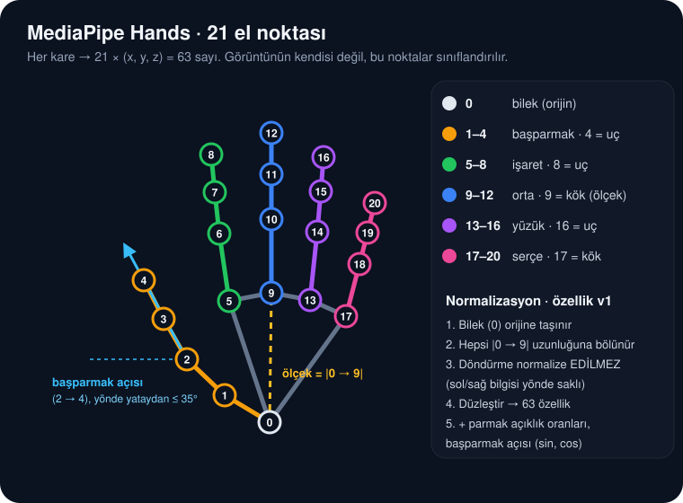<br><sub><b>21 el noktası</b> · modelin gördüğü şey (§10.2)</sub></td>
</tr>
</table>

> [!NOTE]
> Bu sayfadaki çizimler ve arayüz görselleri **konsept / taslaktır**. Ekip tarafından üretildi, ölçekli değildir. Gerçek araç fotoğrafları ve ölçüm grafikleri ilgili hafta bitince `docs/assets/` klasörüne eklenir. Grafiklerdeki sayılar **hedef ve tahmindir**, ölçüm değildir.

---

## İçindekiler

1. [Tek Bakışta](#1-tek-bakışta)
2. [Hareket Seti v5 🔒](#2-hareket-seti-v5-)
3. [Sürüş Mantığı ve Durum Makinesi 🔒](#3-sürüş-mantığı-ve-durum-makinesi-)
4. [Sistem Mimarisi](#4-sistem-mimarisi)
5. [Klasör Yapısı](#5-klasör-yapısı)
6. [Yazılım Gereksinimleri](#6-yazılım-gereksinimleri)
7. [Kapsam ve Sınırlar](#7-kapsam-ve-sınırlar)
8. [Güvenlik Katmanları 🔒](#8-güvenlik-katmanları-)
9. [Veri Seti](#9-veri-seti)
10. [Model: Özellik Çıkarımı ve Eğitim](#10-model-özellik-çıkarımı-ve-eğitim)
11. [Haberleşme Protokolü 🔒](#11-haberleşme-protokolü-)
12. [Araç Tarafı: Firmware ve Donanım](#12-araç-tarafı-firmware-ve-donanım)
13. [Ayarlar (`config.py`)](#13-ayarlar-configpy)
14. [Kurulum ve Çalıştırma](#14-kurulum-ve-çalıştırma)
15. [Test ve Kabul Kriterleri](#15-test-ve-kabul-kriterleri)
16. [Kayıt (Log) Formatı](#16-kayıt-log-formatı)
17. [Yol Haritası (6 Hafta)](#17-yol-haritası-6-hafta)
18. [Ekip ve Sahiplik](#18-ekip-ve-sahiplik)
19. [Git ve Kod Kuralları](#19-git-ve-kod-kuralları)
20. [Sorun Giderme](#20-sorun-giderme)
21. [Riskler ve Açık Kararlar](#21-riskler-ve-açık-kararlar)
22. [Sözlük](#22-sözlük)
23. [Değişiklik Geçmişi](#23-değişiklik-geçmişi)
24. [Sayılarla HandPilot-Car](#24-sayılarla-handpilot-car)
25. [Şablonlar](#25-şablonlar)
26. [Lisans](#26-lisans)

---

## 1. Tek Bakışta

| | |
|---|---|
| **Ne?** | Laptop kamerası eli görür → bilgisayar hareketi tanır → komut WiFi ile ESP32'ye gider → araç hareket eder. |
| **Nasıl kontrol edilir?** | ✊ **Yumruk = gaz** (mandallı, açık ele kadar sürer) · ✋ **Açık avuç = fren** · ⬅️ / ➡️ **Yumruk + başparmak yana = yön** · **Hepsi yalnızca sağ elle** |
| **Nasıl tanınır?** | MediaPipe elde 21 nokta bulur → noktalar normalize edilir → **kendi veri setimizle eğitilmiş** küçük bir sınıflandırıcı + geometrik kural kontrolü. |
| **Güvenlik** | Fren her zaman kazanır. El 0.5 sn kaybolursa durur. Laptop susarsa araç 1 sn sonra kendi durur. |
| **Hedef** | Fren gecikmesi ≤ 300 ms, gaz ↔ fren karışması **0**, 60 sn kesintisiz tur, 10 dk 0 kopma. |

### Proje durumu

| Parça | Durum |
|---|---|
| Plan, el kitabı (`EL_KITABI.md`), sunum | ✅ Var (V4; hareket seti bu README ile **v5'e güncellendi**) |
| Veri toplama aracı (`tools/collect_dataset.py`) | ✅ Var |
| Özellik çıkarımı, eğitim, değerlendirme araçları | 🔜 Hafta 2 |
| Laptop uygulaması (`handpilot/`, `main.py`) | 🔜 Hafta 2–4 |
| ESP32 firmware (`firmware/`) | 🔜 Hafta 3 |
| Donanım siparişi (13 kalem: ESP32, TB6612FNG, 4×AA Ni-MH…) | ✅ Verildi (H1) |
| Görseller, şablonlar, lisans (`docs/`, `.github/`, `LICENSE`) | ✅ Var |

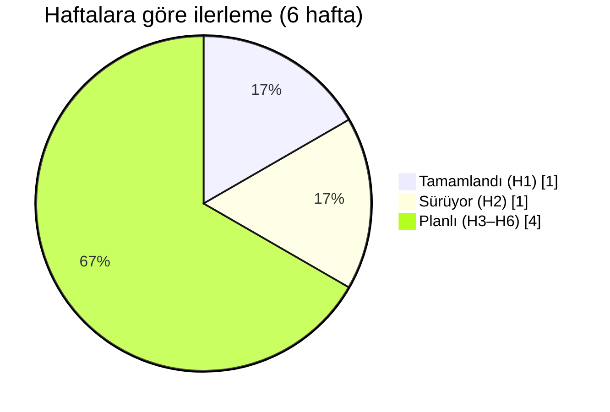

---

## 2. Hareket Seti v5 🔒

### 2.1 Dört hareket

<p align="center">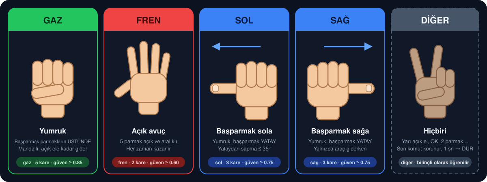</p>

| Komut | Hareket | Nasıl yapılır | Model sınıfı |
|---|---|---|---|
| **GAZ** | ✊ **Yumruk** | 4 parmak avuca kapalı, **başparmak parmakların üstünde** (içeride değil). Parmak boğumları kameraya bakar, bilek düz. | `gaz` |
| **FREN** | ✋ **Açık avuç** | 5 parmak **tamamen açık ve aralıklı**, avuç içi kameraya, parmaklar yukarı. Trafik polisinin "DUR" işareti. | `fren` |
| **SOL** | ⬅️ **Yumruk, başparmak sola** | 4 parmak yumruk, **başparmak dışarıda ve yatay**, ekranda sola bakar. Başparmak kameraya değil, yana doğrultulur. | `sol` |
| **SAĞ** | ➡️ **Yumruk, başparmak sağa** | Aynısı, başparmak ekranda sağa bakar. | `sag` |
| *(hiçbiri)* | Yarı açık el, 2 parmak, OK, başparmak yukarı, geçişler… | Model bunları **bilinçli olarak** "diğer" diye öğrenir. | `diger` |

> **Bütün hareketler yalnızca SAĞ elle yapılır.** Veri toplamada da sürüşte de sol el kullanılmaz.
>
> **"Sol" ve "sağ" ekrana göredir.** Görüntü aynalanır (selfie gibi), yani sürücünün kendi solu ekranda da soldur. Aynalama hem veri toplamada hem sürüşte **aynı** olmalıdır (`MIRROR = True`).

### 2.2 Neden bu hareketler? (v4'ten v5'e geçiş gerekçesi)

v4'te yön, **elin ekrandaki konumu** ile veriliyordu (ekranı üçe bölmek). Parmak durumu da y-koordinatıyla ("uç boğumdan yukarıda mı?") okunuyordu. Bunun sorunları:

- Yön vermek için bütün kolu taşımak gerekiyor; kol yoruluyor, el bölge sınırında titreyince komut zıplıyor.
- "Uç yukarıda mı?" kuralı **el döndüğünde bozuluyor**: yana uzanan parmak kapalı sayılıyor.
- Parmak alfabesi deneyimi gösterdi ki **tek tek parmak ayrımına dayanan** hareketler (2 parmak / 3 parmak gibi) MediaPipe'ta güvenilir değil.

v5 bunun yerine **üç kaba şekil ailesi** kullanır, ve yönü şekilden değil **geometriden** okur (v5.1: yön işaret parmağıyla değil **başparmakla** verilir):

| Şekil ailesi | Hareket | Görsel imza |
|---|---|---|
| Tamamen kapalı | ✊ gaz | Küçük, yuvarlak siluet. Hiçbir parmak bilekten uzaklaşmaz. |
| Tamamen açık | ✋ fren | En büyük siluet. 5 parmak bilekten uzak ve birbirinden ayrık. |
| Yumruk + yana başparmak | ⬅️ ➡️ yön | Yumruk + yana çıkan başparmak. Yönü başparmağın **açısı** belirler. |

### 2.3 Karışma analizi

| Çift | Risk | Neden ayrılır | Ek önlem |
|---|---|---|---|
| ✊ gaz ↔ ✋ fren | **Kritik** | 0 açık parmak ↔ 5 açık parmak; şekil uzayının iki ucu. | Gaz için **iki anahtar** (model + kural), fren için tek anahtar yeter. Belirsiz = `diger`. |
| ✊ gaz ↔ ⬅️➡️ yön | Orta (sürüşte zararsız) | İkisi de yumruk; fark **yalnızca başparmak**: gazda parmakların üstünde, yönde yana uzanmış. | Kural kontrolü: yönde başparmak açık + yatay, gazda başparmak kapalı. Gaz verisinde başparmak yana çıkmaz. |
| ✋ fren ↔ ⬅️➡️ yön | Düşük | 5 parmak ↔ yalnızca başparmak. | — |
| ⬅️ sol ↔ ➡️ sağ | Orta | Şekil aynı, **yön zıt**. Model değil geometri karar verir: başparmak vektörünün x işareti. | Başparmak yataydan ±35°'den fazla saparsa → `diger`. |
| herhangi ↔ yarı açık el | Orta | `diger` sınıfı yarı açık eli ve geçişleri **açıkça** öğrenir. | Düşük güven → önceki komut korunur. |

### 2.4 Doğru / yanlış

| ✅ Doğru | ❌ Yanlış | Neden |
|---|---|---|
| Başparmak yumruğun üstünde | Başparmak avucun içinde | MediaPipe görmediği başparmağı "uyduruyor", noktalar zıplıyor. |
| Açık elde parmaklar aralıklı | Parmaklar bitişik | Bitişik parmaklar tek parça görünüp sayılamıyor. |
| Yönde başparmak **yana** uzanıyor | Başparmak **kameraya** ya da yukarı doğru | Kameraya bakan başparmak kısalır (perspektif), gaz sanılır. |
| Gazda başparmak **parmakların üstünde** | Gazda başparmak yana çıkmış | Yana çıkan başparmak yön hareketiyle karışır. |
| **Sağ el** | Sol el | Veri seti yalnızca sağ elle toplanır. |
| El 40–80 cm, kadrajın ortasında | Kadraj kenarında, yarım el | Kesik el = eksik nokta = yanlış karar. |
| Komutu **tut** | Sallama | Sistem anlık şekle değil, birkaç karenin onayına bakar. |

---

## 3. Sürüş Mantığı ve Durum Makinesi 🔒

### 3.1 Kurallar

1. **Araç yalnızca yumrukla kalkar.** Duruyorken ⬅️/➡️ araç hareket ettirmez.
2. **Gaz mandallıdır.** Yumruk bir kez onaylanınca araç gider ve **açık el gelene kadar** gitmeye devam eder.
3. **Giderken yön:** ⬅️ / ➡️ tutulduğu sürece kavis yapar (iç teker %40). Yumruğa dönünce düz gider.
4. **Fren her zaman kazanır.** Açık el onaylandığı anda araç durur ve mandal kalkar. Tekrar gitmek için yeni yumruk gerekir.
5. **El 0.5 sn görünmezse** araç durur, mandal kalkar.
6. **"Diğer" / düşük güven** gelirse son komut korunur. Ama bu durum **1.0 sn'yi aşarsa** araç durur ("şüphedeysen dur").
7. **Bağlantı kesilirse** veya program kapanırsa araç durur (bkz. [Güvenlik Katmanları](#8-güvenlik-katmanları-)).

### 3.2 Asimetrik onay (debounce)

Durmak hızlı, kalkmak temkinli olmalı. Bu yüzden her komutun eşiği farklıdır:

| Komut | Model güveni | Kural kontrolü | Ardışık kare (30 fps) | Yaklaşık onay süresi |
|---|---|---|---|---|
| ✋ FREN | ≥ 0.60 | **Gerekmez** (tek anahtar) | 2 | ~67 ms |
| ⬅️ / ➡️ YÖN | ≥ 0.75 | 4 parmak kapalı, başparmak açık + açı ±35° | 3 | ~100 ms |
| ✊ GAZ (kalkış) | ≥ 0.85 | Açık parmak (başparmak hariç) ≤ 1 **ve** başparmak açık değil | 5 | ~167 ms |

> Kalkışın frenden bilinçli olarak ~100 ms yavaş olması bir **özelliktir**, hata değil. Geç kalkmak güvenlidir, geç durmak değil.

### 3.3 Durum makinesi

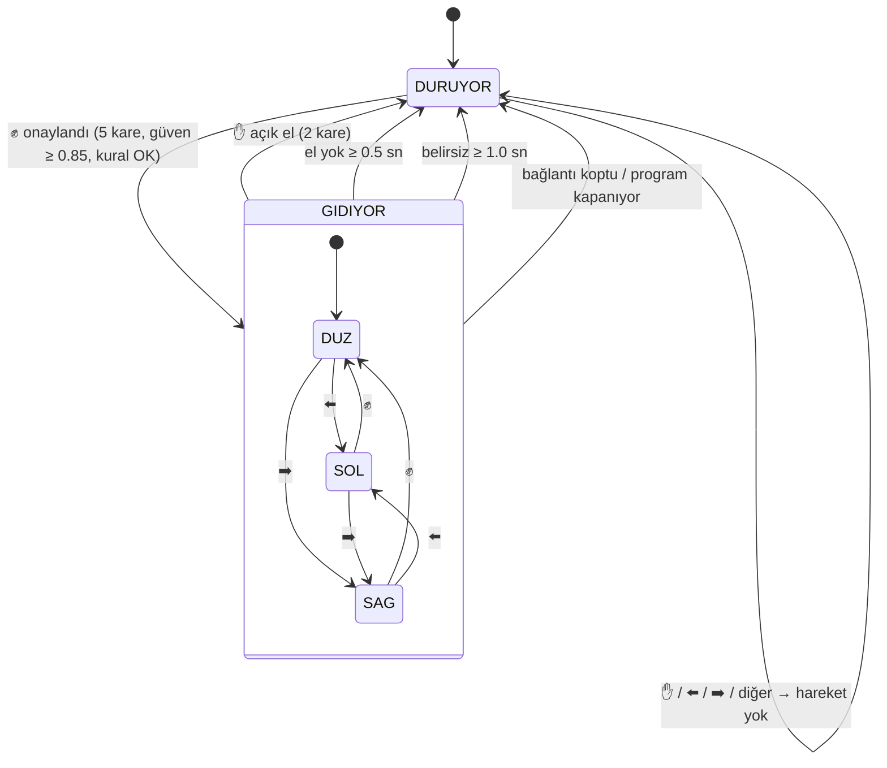

### 3.4 Komut tablosu (durum → araca giden)

| Durum | `d` (sür) | `s` (hız) | `t` (dönüş) | Teker (sol / sağ) |
|---|---|---|---|---|
| DURUYOR | 0 | 0 | N | 0 / 0 |
| GIDIYOR · DUZ | 1 | 180 | N | 180 / 180 |
| GIDIYOR · SOL | 1 | 180 | L | 72 / 180 |
| GIDIYOR · SAG | 1 | 180 | R | 180 / 72 |

İç teker oranı (`0.40`) firmware'dedir. Hız ölü bölgenin (~120) altına düşerse firmware onu `MIN_PWM`'e yükseltir (bkz. [Firmware](#12-araç-tarafı-firmware-ve-donanım)).

---

## 4. Sistem Mimarisi

### 4.1 Genel akış

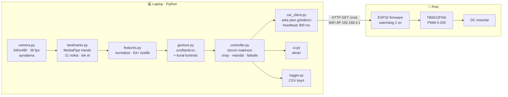

### 4.2 Modüller ve sorumluluklar

| Modül | Tek görevi | Bilmesi **yasak** olan |
|---|---|---|
| `config.py` | Tüm sayılar, eşikler, adresler. **Tek kaynak.** | — (mantık içermez) |
| `camera.py` | Kamerayı açar, kare verir, aynalar, FPS ölçer. | MediaPipe, ağ |
| `landmarks.py` | MediaPipe'ı sarar: kare → 21 nokta (+ el var mı). **MediaPipe yalnızca burada import edilir.** | Ağ, komutlar |
| `features.py` | 21 nokta → normalize özellik vektörü. `FEATURE_VERSION` taşır. Eğitim ve sürüş **aynı** fonksiyonu kullanır. | Kamera, ağ |
| `gesture.py` | Özellik → `GestureResult` (sınıf, güven, kural onayı, yön). Modeli yükler. | Ağ, durum/mandal |
| `controller.py` | `GestureResult` + zaman → `DriveCommand`. Onay sayaçları, mandal, zaman aşımları. **Saf mantık:** kamera, cv2, ağ yok → birim testi kolay. | cv2, ağ, MediaPipe |
| `car_client.py` | `DriveCommand` → HTTP. Arka plan thread, heartbeat, zaman aşımı, bağlantı durumu. | Kamera, el |
| `ui.py` | Ekrana çizim (komut, iskelet, FPS, WiFi, güven). | Ağ, karar mantığı |
| `logger.py` | Her kareyi/komutu CSV'ye yazar. | Karar mantığı |
| `main.py` | Hepsini sırayla çağırır, kapanışta **mutlaka** dur gönderir. **Tek yazarı Furkan.** | Sabit sayı (hepsi `config`'den) |

**Bağımlılık kuralı:** ok yönü tek yöndür, döngü yoktur.
`main → {camera, landmarks, features, gesture, controller, car_client, ui, logger} → config`.
`controller.py` ve `features.py` başka hiçbir proje modülünü import etmez (`config` hariç).

### 4.3 Veri tipleri (modüller arası sözleşme)

```python
@dataclass(frozen=True)
class GestureResult:
    hand_present: bool          # MediaPipe el buldu mu
    label: str                  # "gaz" | "fren" | "sol" | "sag" | "diger" | "yok"
    confidence: float           # 0..1, modelin seçilen sınıf olasılığı
    rule_ok: bool               # geometrik kural modeli onaylıyor mu
    t: float                    # time.monotonic() — karenin zamanı

@dataclass(frozen=True)
class DriveCommand:
    drive: bool                 # True = mandal açık, araç gidiyor
    speed: int                  # 0..255
    turn: str                   # "N" | "L" | "R"
    reason: str                 # "fist_confirmed", "palm", "hand_lost", "unknown_timeout", "link_lost", "exit"...
```

### 4.4 Bir karenin yolculuğu

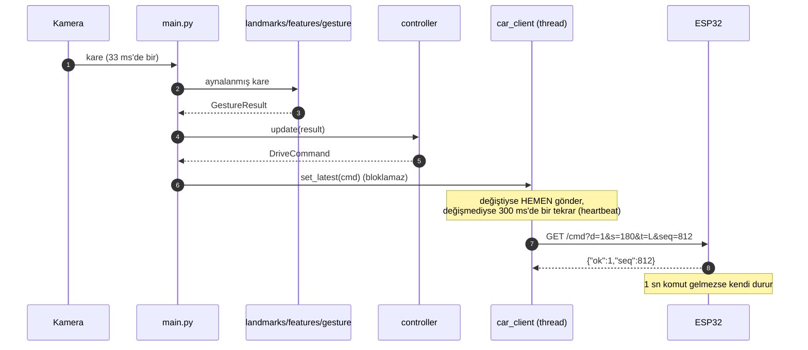

### 4.5 Neden bu tasarım?

- **Görsel yerine nokta tabanlı sınıflandırma:** 21 nokta (63 sayı) arka plandan, ten renginden ve ışıktan büyük ölçüde bağımsızdır. Birkaç bin örnekle yüksek doğruluk verir, CPU'da 1 ms'nin altında çalışır. Görseller yine de saklanır, ileride CNN'e geçmek istersek veri hazırdır.
- **Model + kural (iki anahtar):** Model "ne gördüğünü", kural "fiziksel olarak mantıklı mı?" sorusunu cevaplar. Gaz gibi tehlikeli bir komut ikisinin de onayını ister.
- **Arka plan gönderici:** HTTP isteği 500 ms'ye kadar bekleyebilir. Ana döngü bunu beklerse kamera donar ve fren de gecikir. Gönderici ayrı thread'de "en son komut kazanır" mantığıyla çalışır.
- **Heartbeat:** v4'teki "aynı komut tekrar yollanmaz" kuralı ile "1 sn komutsuz kalınca dur" kuralı birlikte çalışmaz: yumruğu sabit tutan sürücünün aracı her saniye durur. v5'te aynı komut 300 ms'de bir tekrarlanır.

---

## 5. Klasör Yapısı

```text
handpilot-car/
├── README.md                    ← bu dosya (mihenk taşı)
├── LICENSE                      ✅ MIT (kod için; veri seti hariç, §26)
├── .github/                     ✅ PR ve issue şablonları (§25)
├── requirements.txt             ← Python bağımlılıkları (H1 sonunda sürümler kilitlenir)
├── .gitignore
├── veri_topla.py                ✅ ekibe dağıtılan veri toplama (masaüstüne, rastgele adlar)
├── main.py                      🔜 uygulama giriş noktası (tek yazar: Furkan)
├── handpilot/                   🔜 laptop uygulaması
│   ├── __init__.py
│   ├── config.py                    tek sayı kaynağı
│   ├── camera.py
│   ├── landmarks.py
│   ├── features.py
│   ├── gesture.py
│   ├── controller.py
│   ├── car_client.py
│   ├── ui.py
│   └── logger.py
├── tools/                       yardımcı araçlar (uygulamadan bağımsız çalışır)
│   ├── collect_dataset.py       ✅ gelişmiş veri toplama (CLI, el kontrolü, diger sınıfı)
│   ├── extract_landmarks.py     🔜 görseller → dataset/landmarks.csv
│   ├── train_classifier.py      🔜 landmarks.csv → models/gesture_clf.joblib
│   ├── evaluate.py              🔜 kişi bazlı test, karışıklık matrisi
│   ├── review_dataset.py        🔜 hatalı kareleri gözle ayıklama
│   ├── test_camera.py           🔜 kamera + FPS testi
│   └── keyboard_drive.py        🔜 elsiz, klavyeyle araç sürme (H3)
├── firmware/
│   └── handpilot_esp32/         🔜 Arduino projesi
│       ├── handpilot_esp32.ino
│       └── config.h                 pinler, PWM, watchdog
├── tests/                       🔜 pytest (controller, features, car_client)
├── dataset/
│   ├── raw/                         görseller + metadata.csv   (Git'e GİRMEZ)
│   ├── landmarks.csv                çıkarılmış özellikler       (Git'e girebilir, kişisel veri içermez)
│   └── DATASET.md                   veri seti kartı: sürüm, tarih, kişi/sınıf sayıları
├── models/
│   ├── gesture_clf.joblib           eğitilmiş model
│   └── gesture_clf.json             sınıf listesi, FEATURE_VERSION, metrikler, tarih
├── logs/                            sürüş kayıtları            (Git'e GİRMEZ)
├── reports/                         grafikler, karışıklık matrisi (rapora girer)
└── docs/
    ├── assets/                      ✅ README görselleri (SVG): prototip, şema, grafikler
    ├── templates/                   ✅ veri seti kartı, haftalık rapor, test kaydı, rıza formu
    └── …                            EL_KITABI, sunum (şu an kök dizinde, taşınacak)
```

---

## 6. Yazılım Gereksinimleri

### 6.1 Fonksiyonel gereksinimler

| Kod | Gereksinim |
|---|---|
| FR-01 | Kamera 640×480'de ≥ 25 fps okunur; kare aynalanır (`MIRROR`). |
| FR-02 | MediaPipe tek elle çalışır (`max_num_hands=1`); el yoksa `hand_present=False`. |
| FR-03 | Her kare 5 sınıftan birine (`gaz`, `fren`, `sol`, `sag`, `diger`) + güven puanına çevrilir. |
| FR-04 | Komut onayı asimetriktir: fren 2, yön 3, gaz 5 ardışık kare (bkz. §3.2). |
| FR-05 | Gaz mandallıdır; yalnızca fren, el kaybı, belirsizlik zaman aşımı, bağlantı kaybı veya çıkış mandalı kaldırır. |
| FR-06 | Yön komutları yalnızca GIDIYOR durumunda etkilidir. |
| FR-07 | El ≥ 0.5 sn görünmezse DUR. |
| FR-08 | GIDIYOR iken `diger`/düşük güven ≥ 1.0 sn sürerse DUR. |
| FR-09 | Komut değişince **hemen**, değişmezse **300 ms'de bir** (heartbeat) gönderilir. |
| FR-10 | Saniyede en fazla 5 istek. **Fren/DUR bu sınıra takılmaz.** |
| FR-11 | HTTP zaman aşımı 0.5 sn. 3 ardışık hata → "BAĞLANTI YOK" durumu, mandal kalkar, yeniden bağlanma denenir. |
| FR-12 | Çıkışta (Q, Ctrl+C, beklenmeyen hata) araca `/stop` gönderilir (`try/finally` + `atexit` + SIGINT). |
| FR-13 | Ekranda: büyük komut yazısı (gaz yeşil, fren kırmızı, yön mavi), durum (DURUYOR/GIDIYOR), güven çubuğu, el iskeleti, FPS, WiFi durumu + ping, yardım satırı. 3 m'den okunur. |
| FR-14 | Her kare ve her gönderim CSV'ye kaydedilir (bkz. §16). |
| FR-15 | FPS < 15 olursa: MediaPipe `model_complexity=0`, gerekirse kare küçültülür; ekranda uyarı. |
| FR-16 | Kodda sabit sayı yoktur; her sayı `config.py`'den okunur. |
| FR-17 | Veri toplama aracı: molalı turlar, saniyede kare, metadata, tur tekrarı (✅ `tools/collect_dataset.py`). |
| FR-18 | Model dosyası `FEATURE_VERSION` ve sınıf listesi taşır; uyuşmazsa uygulama **başlamaz** (sessizce yanlış çalışmaz). |
| FR-19 | Firmware: AP, `/`, `/cmd`, `/stop`, `/status`, watchdog, açılışta motorlar kapalı, hız sınırlama. |
| FR-20 | Klavye modu (test): `W` gaz (mandal), `SPACE` fren, `A`/`D` basılı tutulunca yön, `Q` çıkış. Aynı `controller` ve `car_client` kullanılır. |

<details>
<summary><b>FR-13 sürüş ekranı taslağı</b> (tıkla)</summary>
<br>


Sol üst: büyük komut + durum · sağ üst: WiFi, ping, FPS · sol alt: güven çubuğu (sarı çizgi = `CONF_GAZ` eşiği) ve onay sayacı · alt: yardım satırı. Ekrandaki yazılar ASCII'dir (§19, `cv2.putText`).
</details>

### 6.2 Fonksiyonel olmayan gereksinimler

| Kod | Gereksinim | Ölçü |
|---|---|---|
| NFR-01 | Fren gecikmesi (el açıldı → teker durmaya başladı) | ≤ 300 ms |
| NFR-02 | Gaz gecikmesi (yumruk → teker döndü) | ≤ 400 ms |
| NFR-03 | Uçtan uca döngü hızı (sunum laptopunda) | ≥ 20 fps |
| NFR-04 | Çevrimdışı doğruluk (hiç görülmemiş kişide) | Her sınıfta recall ≥ %95 |
| NFR-05 | Gaz ↔ fren karışması (test setinde) | **0** |
| NFR-06 | Bağlantı kararlılığı | 10 dk sürüşte 0 kopma |
| NFR-07 | Modülerlik | §4.2 bağımlılık kuralları ihlal edilmez |
| NFR-08 | Test edilebilirlik | `controller.py`'deki her durum geçişinin birim testi var |
| NFR-09 | Taşınabilirlik | macOS ve Windows'ta aynı komutlarla çalışır |
| NFR-10 | Gizlilik | Ham görüntüler Git'e girmez; katılımcı kodu kullanılır (§9.7) |
| NFR-11 | Kurulum | Temiz laptopta README ile ≤ 15 dk |
| NFR-12 | Kod kalitesi | PEP 8, type hint, `ruff` temiz |

### 6.3 Yazılım ortamı

| Bileşen | Sürüm / not |
|---|---|
| Python | **3.10** (ekipte tek sürüm; 3.12 MediaPipe ile sorun çıkarabilir) |
| `opencv-python` | Kamera, çizim |
| `mediapipe` | El noktaları. Sürüm **kilitlenir**: yeni sürümlerde eski `mp.solutions` API'si kaldırılıyor, Tasks API'ye (`HandLandmarker`) geçiş gerekebilir |
| `numpy` | Özellikler |
| `scikit-learn`, `joblib` | Sınıflandırıcı |
| `requests` | HTTP (`Session` ile keep-alive) |
| `pytest`, `ruff` | Test, stil |
| Arduino IDE + ESP32 kart paketi | **2.0.x** (3.x'te PWM API'si farklı, §12.5) |

---

## 7. Kapsam ve Sınırlar

### 7.1 Kapsam

| ✅ İçeride | ❌ Bilerek dışarıda (raporun "gelecek çalışma" kısmına) |
|---|---|
| Tek el (sağ el ile eğitilir) | İki elle kontrol |
| 4 komut + "diğer" | Geri vites, yerinde dönüş, değişken hız (opsiyonel ekstra, §21) |
| Aynı WiFi ağı (araç AP'si) | İnternet üzerinden sürme |
| Düz, kaymayan zemin, 3×3 m pist | Yağmur, çim, eğim |
| El kaybında, bağlantı kaybında otomatik durma | Otonom sürüş, engel algılama (opsiyonel ekstra) |
| 1 araç, 1 laptop | Çoklu araç / çoklu sürücü |

### 7.2 Çalışma zarfı (sistemin söz verdiği koşullar)

| Koşul | Sınır | Dışına çıkılırsa |
|---|---|---|
| Işık | Normal oda/ofis ışığı, el önden aydınlık, **arkada pencere yok** | El bulunamaz → araç durur |
| Mesafe | El–kamera 40–80 cm | Uzakta noktalar titrer, yakında el kadraja sığmaz |
| Kadraj | Tek el, arkada hareket eden insan yok | MediaPipe başka eli takip edebilir |
| Ağ | 2.4 GHz, araç–laptop ≤ 5 m, laptop güç tasarrufu kapalı | Gecikme artar, heartbeat kaçar → araç durur |
| Pil (4×AA Ni-MH) | Yüksüz ≥ 5.0 V, yükte ≥ 4.4 V | Önce WiFi kopar (ESP32 yeniden başlar), sonra motor titrer |
| Laptop | Şarja takılı, kamera kullanan başka uygulama kapalı | FPS düşer |

### 7.3 Bilinen sınırlamalar

- **Veri setinde ne yoksa model onu bilmez.** Eldiven, yüzük, uzun kollu kazak, farklı ten rengi veri setinde yoksa doğruluk düşer. Sunumda bunlardan biri kullanılacaksa veri setine de eklenir.
- **Yalnızca sağ el desteklenir.** Sol elle veri toplanmaz, sürüş de sağ elle yapılır. Sol elde başparmak ters tarafta kaldığı için yön hareketleri güvenilir değildir.
- Kontrol açık döngüdür: aracın gerçek hızı/konumu ölçülmez, iki motorun hız farkı sadece PWM ile dengelenir.

---

## 8. Güvenlik Katmanları 🔒

Araç, **herhangi bir katman** "dur" derse durur. Katmanlar birbirinden bağımsızdır.

<p align="center">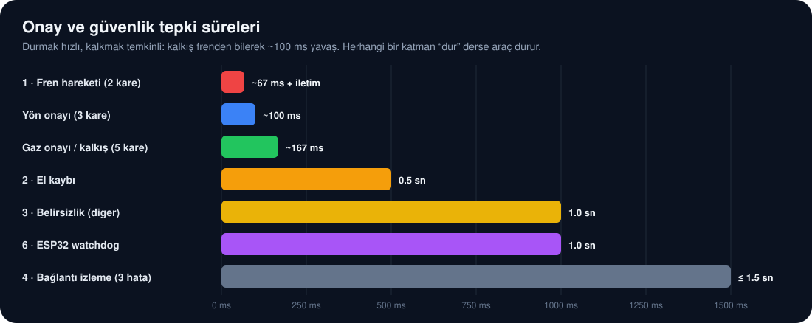</p>

| # | Katman | Nerede | Tetikleyici | Tepki süresi |
|---|---|---|---|---|
| 1 | Fren hareketi | controller | ✋ 2 kare | ~67 ms + iletim |
| 2 | El kaybı | controller | El yok ≥ 0.5 sn | 0.5 sn |
| 3 | Belirsizlik | controller | `diger`/düşük güven ≥ 1.0 sn | 1.0 sn |
| 4 | Bağlantı izleme | car_client | 3 ardışık hata | ≤ 1.5 sn |
| 5 | Program çıkışı | main | Q, Ctrl+C, hata | anında `/stop` |
| 6 | **Watchdog** | ESP32 | 1 sn komut gelmedi (laptop dondu, WiFi koptu) | 1 sn |
| 7 | Açılış güvenliği | ESP32 | Açılış/yeniden başlama | Motor pinleri WiFi'den **önce** LOW |
| 8 | Fiziksel | Araç | IC205 kayar anahtar, 2 A cam sigorta | anında |

Pist kuralları: araç seyirciye doğru sürülmez, pist bantla çevrilir, seyirci 1 m geride durur, pil ısınırsa mola verilir.

---

## 9. Veri Seti

### 9.1 Neden kendi veri setimiz?

Hazır hareket modelleri bizim 4 hareketimizi, kameramızı, ışığımızı ve ellerimizi bilmez. 8 kişiden toplanan kontrollü veriyle model **tam bizim koşullarımıza** göre öğrenir. En önemlisi de "diğer" sınıfını, yani **yanlışlıkla gaz verilmemesi gereken her şeyi**, açıkça öğretebiliriz.

### 9.2 Sınıflar ve hedef sayılar

| Sınıf | Kişi başı | 8 kişi toplam |
|---|---|---|
| `gaz` | 300 | 2400 |
| `fren` | 300 | 2400 |
| `sol` | 300 | 2400 |
| `sag` | 300 | 2400 |
| **Toplam** | **1200** | **9600** |
| `diger` *(önerilir, §2.3)* | 300 | 2400 |

<p align="center">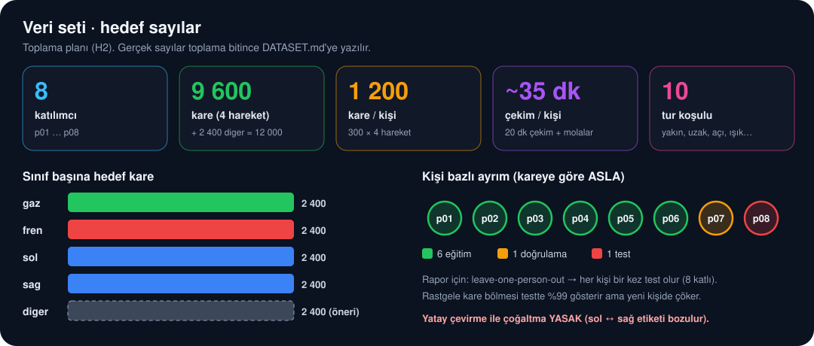</p>

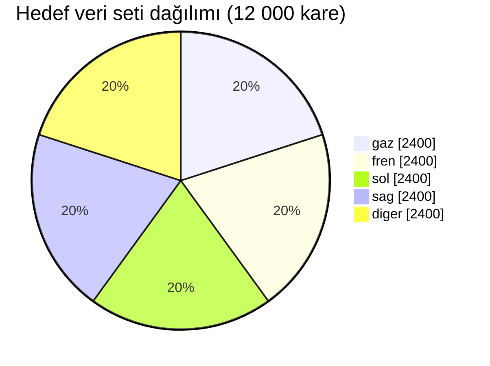

**Kişi başı çekim süresi (`veri_topla.py` varsayılanları):**

| Kalem | Hesap | Süre |
|---|---|---|
| Çekim | 4 hareket × 300 kare × 1 sn | 20 dk |
| Molalar | 4 hareket × 9 mola × 20 sn | 12 dk |
| Geri sayım | 4 hareket × 10 tur × 3 sn | 2 dk |
| **Toplam** | | **≈ 34–35 dk** |

### 9.3 Ekibe dağıtılan araç: `veri_topla.py` ✅

Tek dosyadır, yalnızca `opencv-python` ister. Her ekip üyesine gönderilir ve herkes kendi bilgisayarında çalıştırır.

```bash
pip install opencv-python
python veri_topla.py          # katılımcı kodunu sorar (p01…p08)
```

<p align="center"><br><sub>Çekim ekranı (temsili): üstte hareket ve sayaç, sağ üstte son kayıt, altta ipuçları ve turun koşulu. Yeşil çerçeve = kare kaydedildi.</sub></p>

- Her saniye 1 fotoğraf çeker. Hareket başına **300 fotoğraf**, 30 fotoğraflık 10 tur, turlar arası 20 sn mola.
- Ekranda yapılacak hareket, nasıl yapılacağına dair ipuçları, turun koşulu ve **son kaydedilen fotoğraf** görünür.
- **Bütün hareketler yalnızca sağ elle** çekilir (ekranda da yazar).
- **Hareket atlama (`S`):** Bir hareketi daha önce bitiren (örn. gazı tamamlamış) kişi `S`'ye basar, program frene geçer; tekrar `S` → sol, tekrar `S` → sağ. `S` her ekranda çalışır: giriş ekranında, geri sayımda, çekimde (yarım tur **silinir**) ve molada (biten tur **kaydedilir**). Aynı kodla, aynı bilgisayarda tamamlanmış hareketler zaten otomatik atlanır.
- Kayıt yeri: **Masaüstü/HandPilot_Veri/** (Windows OneDrive masaüstü dahil, bulunamazsa ana klasör).

```text
HandPilot_Veri/
├── gaz/   k3x9q2ma.jpg …     ← adlar rastgele 8 karakter (küçük harf + rakam)
├── fren/
├── sol/
├── sag/
└── kayit_p01.csv            ← dosya → kişi, tur, zaman (KAYBEDİLMEMELİ)
```

- **Birleştirme:** 8 kişinin `gaz/`, `fren/`, `sol/`, `sag/` klasörleri tek klasörde birleştirilir. Adlar rastgele olduğu için çakışma olmaz (36⁸ ≈ 2.8 trilyon olasılık). Adlar yalnızca küçük harften oluşur, çünkü Windows ve macOS `A` ile `a` harflerini aynı dosya sayar.
- **`kayit_<kod>.csv` dosyaları mutlaka birlikte toplanır.** Dosya adında kişi bilgisi yoktur. Kişi bazlı eğitim/test ayrımı (§9.6-2) yalnızca bu dosyalar sayesinde yapılabilir. Her kişinin kodu farklı olmalıdır.
- Yarıda kalırsa program yeniden çalıştırılır ve **aynı kod** girilir: kaldığı yerden devam eder.
- Ayarlar dosyanın başındadır (`PHOTOS_PER_GESTURE`, `REST_SECONDS`…). `MIRROR` değiştirilmez.

| Tuş | İşlev |
|---|---|
| `SPACE` | Başla / molayı geç |
| `P` | Duraklat / devam |
| `R` | Turu baştan çek |
| `S` | Bu hareketi atla, sıradakine geç (gaz → fren → sol → sag) |
| `Q` / `ESC` | Kaydet ve çık (yarım tur kaydedilmez) |

### 9.3.1 Gelişmiş araç: `tools/collect_dataset.py`

```bash
# Bir kişinin bütün hareketleri (gaz → fren → sol → sag → diger), ~23 dk
python tools/collect_dataset.py --person p01

# Sadece bir/birkaç hareket
python tools/collect_dataset.py --person p01 --gesture fren
python tools/collect_dataset.py --person p01 --gesture sol,sag

# Hareket başına 300 görsel (10 tur)
python tools/collect_dataset.py --person p01 --rounds 10

# Tüm seçenekler
python tools/collect_dataset.py --help
```

**Bir hareketin akışı:**

```text
[Giriş ekranı: hareket nasıl yapılır]  --SPACE-->
  Tur 1: 3 sn geri sayım → 30 sn çekim (her saniye 1 kare, yeşil çerçeve = kaydedildi)
  → 20 sn MOLA (el kontrol sonucu gösterilir, R ile tur silinip tekrar çekilebilir)
  Tur 2 … Tur 5 (her tur farklı koşul)
[Sonraki hareketin giriş ekranı]
```

**Her tur farklı bir koşulda çekilir** (ekranda yazar):

| Tur | Koşul |
|---|---|
| 1 | Normal: el ekranın ortasında, ~50 cm |
| 2 | Yakın: ~40 cm |
| 3 | Uzak: ~80 cm |
| 4 | Konum: el ekranda yavaşça gezdirilir (sol-orta-sağ, yukarı-aşağı) |
| 5 | Açı: bilek hafifçe çevrilir, el az eğilir (hareket bozulmadan) |

**Tuşlar:**

| Tuş | İşlev |
|---|---|
| `SPACE` | Başla / molayı geç |
| `P` | Duraklat / devam |
| `R` | Turu baştan çek (çekimde: yarım tur silinir · molada: biten tur silinir) |
| `S` | Bu hareketi atla (giriş ekranında) |
| `Q` / `ESC` | Kaydet ve çık (yarım kalan tur **asla** kaydedilmez) |

**Önemli parametreler:** `--fps` (varsayılan 1), `--duration` (30), `--rounds` (5), `--rest` (20), `--countdown` (3), `--camera` (0), `--no-mirror`, `--no-hand-check`, `--out` (`dataset/raw`).

**Çıktı:**

```text
dataset/raw/
├── metadata.csv
├── gaz/p01/p01_gaz_20261012-141502_r01_001.jpg
├── gaz/p01/p01_gaz_20261012-141502_r01_002.jpg
├── ...
└── diger/p08/...
```

`metadata.csv` sütunları: `file, person, gesture, session, round, index, timestamp, width, height, mirrored, hand_detected, hint`.
`hand_detected` sütunu MediaPipe kuruluysa her karede el bulunup bulunmadığını yazar (1/0). Kurulu değilse boş kalır. Kayıt **görüntü üzerine yazı çizilmeden**, temiz kare olarak yapılır. Ekrandaki yazılar sadece önizlemededir.

### 9.4 Çekim protokolü (her katılımcı için)

1. Sunum laptopu veya kendi laptopun, **şarjda**. Kamerayı kullanan diğer uygulamalar kapalı.
2. Işık önden. Arkada pencere ya da hareket eden insan olmasın.
3. **Sadece sağ el.** Yüzük/saat varsa bir oturum takılı, bir oturum çıkarılmış çekilmesi tercih edilir.
4. Hareket boyunca el **sabit durmaz**: her karede hafifçe farklı olsun (biraz kaydır, biraz döndür). 1 kare/sn hızı bunun için seçildi: ardışık kareler birbirinin kopyası olmasın.
5. `diger` turunda **yaratıcı ol**: yarı açık el, 2–3 parmak, OK işareti, başparmak yukarı, başparmak kameraya doğru, el yandan, yumruktan açığa yavaş geçiş, işaret parmağı yukarı veya yana. Model "bunlar gaz değil" bilgisini buradan öğrenir.
6. Molada el kontrol sonucu kırmızıysa (3'ten fazla karede el bulunamadıysa) `R` ile tur tekrar çekilir.

### 9.5 Çeşitlilik kontrol listesi

- [ ] 8 kişinin hepsi (farklı el boyu ve ten rengi)
- [ ] En az 2 farklı ışık (gündüz pencere ışığı önden + akşam tavan lambası)
- [ ] En az 2 farklı arka plan (duvar + dağınık oda)
- [ ] Kısa kol ve uzun kol
- [ ] Mümkünse 2 farklı gün (aynı kişi, farklı oturum)
- [ ] **Sunumun yapılacağı oda ve laptop** (en az 2 kişi, sunumdan önceki hafta)

### 9.6 Veri setinin altın kuralları

1. **Yatay çevirme (flip) ile çoğaltma YASAK.** Çevrilen ⬅️ görüntüsü ➡️ olur, etiket yanlışlanır. İzin verilen çoğaltmalar: parlaklık/kontrast, ±10° döndürme, ±%10 ölçek, küçük kaydırma (nokta düzeyinde: küçük gürültü).
2. **Eğitim/test ayrımı kişiye göre yapılır, kareye göre ASLA.** Aynı kişinin ardışık kareleri neredeyse aynıdır. Rastgele bölünürse test %99 çıkar ama gerçekte yeni kişide çöker. Yöntem: *leave-one-person-out* (her seferinde bir kişi test). Sunum için: 6 kişi eğitim, 1 doğrulama, 1 test.
3. **Aynalama sabittir.** Toplama ve sürüş aynı `MIRROR` değerini kullanır. `metadata.csv` içindeki `mirrored` sütunu bunu kayıt altında tutar.
4. **Veri seti sürümlenir.** Her eğitimde `dataset/DATASET.md` içine şunlar yazılır: sürüm (v1, v2…), tarih, kişi × sınıf tablosu, silinen kare sayısı ve nedeni.
5. **Hatalı kare silinir, düzeltilmez.** Yanlış etiketli bir kare, hiç olmamasından daha kötüdür. `review_dataset.py` (🔜) ile ya da klasörde gözle bakılarak temizlenir. Sınıf klasöründe olup MediaPipe'ın el bulamadığı kareler (`hand_detected=0`) özellik çıkarımında otomatik elenir.

### 9.7 Gizlilik ve rıza (KVKK)

- Görüntülerde **yüz** de görünür. Her katılımcıdan yazılı **açık rıza** alınır (amaç: yalnızca bu ders projesi; süre: proje bitimi + 1 yıl).
- Dosya adlarında gerçek isim değil **katılımcı kodu** (`p01`…`p08`) kullanılır. Kod ↔ isim eşleşmesi yalnızca Furkan'da, repoda değil.
- `dataset/raw/` **Git'e girmez** (`.gitignore`), paylaşılırsa özel bir sürücüden paylaşılır. `landmarks.csv` sadece sayılardan oluşur, repoya konabilir.
- Katılımcı isterse verisi silinir; model yeniden eğitilir.

---

## 10. Model: Özellik Çıkarımı ve Eğitim

### 10.1 Boru hattı

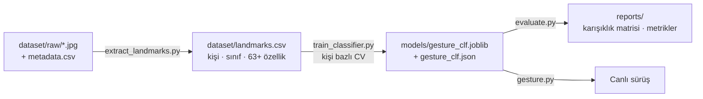

### 10.2 Özellikler (`features.py`, `FEATURE_VERSION = 1`)

<p align="center"></p>

1. 21 nokta `(x, y, z)` alınır (aynalanmış kare üzerinden).
2. **Öteleme:** bilek (nokta 0) orijine taşınır.
3. **Ölçek:** tüm koordinatlar `|bilek → orta parmak kökü (nokta 9)|` mesafesine bölünür. Böylece el uzak ya da yakın olsa da aynı sayılar elde edilir.
4. **Döndürme normalize EDİLMEZ.** Yön bilgisi (⬅️ / ➡️) koordinatların yönünde saklıdır, döndürmek onu siler.
5. Düzleştir → 63 sayı. Ek mühendislik özellikleri (önerilen): 5 parmağın açıklık oranı, başparmağın açısı `(sin, cos)`, parmak uçları arası ortalama açıklık.

> Eğitim ve canlı sürüş **aynı** `features.py` fonksiyonunu çağırır. Özellik tanımı değişirse `FEATURE_VERSION` artırılır ve model yeniden eğitilir. Uyuşmazlıkta uygulama başlamaz (FR-18).

### 10.3 Kural kontrolü (`gesture.py`, dönmeye dayanıklı)

Parmak açıklığı **y-koordinatı ile değil mesafe oranı ile** ölçülür. Bu sayede el döndüğünde de doğru çalışır:

- Parmak (işaret/orta/yüzük/serçe) açık ⇔ `|bilek → uç| / |bilek → PIP eklemi| > EXT_RATIO` (başlangıç değeri 1.15, veriyle ayarlanır)
- Başparmak açık ⇔ `|başparmak ucu → serçe kökü| > |başparmak IP → serçe kökü| × EXT_RATIO`

| Model sınıfı | Kural onayı (`rule_ok`) |
|---|---|
| `gaz` | Açık parmak (başparmak hariç) ≤ 1 **ve** başparmak açık değil |
| `fren` | (kontrol edilir, kaydedilir, **ama fren için şart değil**) |
| `sol` / `sag` | 4 parmak kapalı, başparmak açık **ve** `açı(nokta 2 → nokta 4)` yataydan ≤ 35° **ve** x yönü sınıfla aynı |
| `diger` | — |

Yön **geometriden** okunur: model `sol` dese bile başparmak sağı gösteriyorsa sonuç `diger` olur ve önceki komut korunur.

### 10.4 Sınıflandırıcı

- Başlangıç: `RandomForestClassifier` ve `MLPClassifier` (scikit-learn), taban çizgisi olarak kNN.
- Seçim kriteri sırası: (1) gaz ↔ fren karışması = 0, (2) en kötü sınıfın recall'u, (3) makro F1.
- Çıktı olasılıkları kalibre edilir (gerekirse `CalibratedClassifierCV`), çünkü §3.2'deki eşikler olasılığa dayanır.
- `models/gesture_clf.json` örneği:

```json
{
  "classes": ["diger", "fren", "gaz", "sag", "sol"],
  "feature_version": 1,
  "dataset_version": "v1",
  "trained_at": "2026-10-20T15:42:00",
  "cv": "leave-one-person-out",
  "metrics": {"macro_f1": 0.97, "recall_min": 0.95, "gaz_fren_confusions": 0}
}
```

### 10.5 Değerlendirme raporu (rapora girer)

- Kişi bazlı karışıklık matrisi (5×5) → `reports/confusion_matrix.png`
- Sınıf başına precision/recall/F1 tablosu
- **Gaz ↔ fren karışma sayısı** ayrı başlıkta
- En kötü kişi ve en kötü koşul (yakın/uzak/açı) analizi: `metadata.csv` içindeki `hint` sütunu sayesinde mümkün

---

## 11. Haberleşme Protokolü 🔒

**Taşıma:** HTTP/1.1 GET, ESP32 Access Point. SSID `HandPilot-Car`, şifre ≥ 8 karakter, IP `192.168.4.1`, port 80, **en fazla 1 istemci**.

| Uç nokta | Parametreler | Cevap | Amaç |
|---|---|---|---|
| `GET /` | — | `HandPilot-Car OK` | Tarayıcıdan canlılık testi |
| `GET /cmd` | `d` ∈ {0,1}, `s` ∈ 0–255, `t` ∈ {N,L,R}, `seq` (artan tam sayı) | `{"ok":1,"seq":812}` | Sürüş komutu (heartbeat de budur) |
| `GET /stop` | — | `{"ok":1}` | Anında dur (çıkışta, acilde) |
| `GET /status` | — | `{"uptime_ms":…, "last_cmd_age_ms":…, "seq":…, "vbat":7.62}` | Teşhis (`vbat` pil ekstrası alınırsa) |

**Kurallar:**

- `seq`, son kabul edilenden küçük ya da ona eşitse komut yok sayılır (geç gelen eski paket aracı yeniden kaldıramaz). Laptop yeniden başlayınca `seq` sıfırlanır: firmware, `seq` 1 gelirse sayacı sıfırlar.
- Geçersiz parametre → `400`, motorlar **dur**.
- Gönderim: değişince hemen, değişmezse 300 ms'de bir, en fazla 5 istek/sn (DUR hariç).
- Zaman aşımı 0.5 sn. 3 ardışık hata = bağlantı yok.
- Laptop `requests.Session` kullanır (bağlantı yeniden kullanılır, gecikme düşer).

**Elle test (tarayıcı):** `http://192.168.4.1/cmd?d=1&s=180&t=N&seq=1` → teker döner, 1 sn sonra watchdog durdurur. Bu durma normaldir.

> Neden UDP değil? HTTP tarayıcıdan test edilebilir ve hata ayıklaması kolaydır. Ölçülen gecikme > 80 ms çıkarsa UDP'ye geçiş değerlendirilir (açık karar §21).

---

## 12. Araç Tarafı: Firmware ve Donanım

### 12.1 Firmware sorumlulukları

1. Açılışta **önce** STBY ve motor pinlerini LOW yapar, **sonra** WiFi AP'yi açar.
2. `/cmd` gelince: `s` değerini 0–255 arasına sıkıştırır. `0 < s < MIN_PWM` ise `s = MIN_PWM` olur (ölü bölge). Dönüşte iç teker `s × TURN_INNER`.
3. Son geçerli komutun zamanını tutar. `WATCHDOG_MS` (1000) geçerse durur.
4. Her komutu seri porta yazar (115200 baud), hata ayıklama için.
5. Engelleyici `delay()` kullanmaz; `loop()` her turda `server.handleClient()` ve watchdog kontrolü yapar.

### 12.2 Prototip

<p align="center"></p>

> [!NOTE]
> **v5.2 donanım değişikliği (H1 siparişi):** L298N yerine **TB6612FNG**, 2×18650 yerine **4×AA Ni-MH** kullanılır. TB6612FNG MOSFET tabanlıdır: L298N'deki ~1.5–2 V düşüm yoktur, ESP32'nin 3.3 V mantığıyla doğrudan uyumludur, daha küçük ve serindir.

### 12.3 Malzeme listesi (sipariş edildi)

| # | Malzeme | Adet | Görevi |
|---|---|---|---|
| 1 | 2WD robot araba kiti | 1 | Şasi, 2 teker, sarhoş teker, 2 TT DC motor, pil yuvası |
| 2 | ESP32-WROOM-32D geliştirme kartı | 1 | WiFi AP, HTTP sunucu, PWM, watchdog |
| 3 | TB6612FNG çift motor sürücü | 1 | Yön + hız (kanal başı 1.2 A sürekli, 3.2 A tepe) |
| 4 | GP Recyko 1300 mAh AA Ni-MH (4'lü) | 1 kart | Ana güç: 4.8 V nominal (dolu ~5.6 V) |
| 5 | X-Level USB-C pil şarj cihazı | 1 | 4 yuvalı Ni-MH şarj |
| 6 | 2 A 5×20 mm cam sigorta + kablolu yuva | 1 | Kısa devre / motor kilitlenmesi koruması |
| 7 | Seramik kondansatör (100 nF) | 1 set | Motor fırça gürültüsü, dekuplaj |
| 8 | 50 V 100 µF elektrolitik | 1 paket | VM ani akım tamponu |
| 9 | 5×10 cm pertinaks | 1 | Lehimli ana kart |
| 10 | 40 pin dişi-erkek jumper | 1 | Prototip bağlantıları |
| 11 | IC205 sürgülü switch | 1 | Ana güç anahtarı (güvenlik katmanı 8) |
| 12 | 1 mm makaron | 1 m | Lehim yalıtımı |

**Ek önerilenler:** powerbank + micro-USB (ESP32'yi ayrı beslemek için, **yüksek öncelik**), yedek 4'lü pil, yedek sigorta, pin header, multimetre, 2× 10 kΩ (pil ölçümü), M3 vida/aralık parçası, zemin bandı, *(opsiyonel)* HC-SR04.

### 12.4 Pin planı ve bağlantı şeması

<p align="center">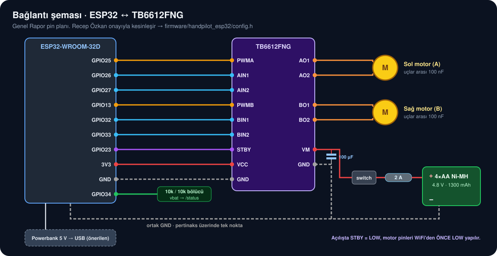</p>

| TB6612FNG | ESP32 | Not |
|---|---|---|
| PWMA | **GPIO25** | Sol motor hızı. GPIO14 kullanılmaz: açılışta kısa PWM verir, motor seğirir |
| AIN1 / AIN2 | GPIO26 / GPIO27 | Sol motor yönü |
| PWMB | **GPIO13** | Sağ motor hızı. GPIO12 kullanılmaz: **strapping** pini, açılışı engelleyebilir |
| BIN1 / BIN2 | GPIO32 / GPIO33 | Sağ motor yönü |
| STBY | GPIO23 | LOW = sürücü kapalı. Açılışta **önce LOW** tutulur |
| VCC | 3V3 | Sürücü mantık beslemesi |
| VM | sigorta + switch sonrası pil (+) | Motor beslemesi, yanında 100 µF |
| GND | GND | **Tek noktada** ortak toprak (pil −, TB6612, ESP32) |
| *(pil ölçümü)* | GPIO34 | 10 kΩ / 10 kΩ bölücü: 5.6 V → 2.8 V → `/status` içinde `vbat` |

> Pin planı elektrik ekibinin (Recep) onayıyla kesinleşir ve `firmware/handpilot_esp32/config.h` dosyasına yazılır. Eski şema görselleri (`assets/05_wiring.svg`, L298N) geçersizdir.

**PWM:** 5000 Hz, 8 bit (0–255). **Güç hattı:** pil (+) → 2 A sigorta → kayar switch → TB6612 VM. Her motorun iki ucu arasına 100 nF seramik kondansatör.

### 12.5 ESP32 Arduino çekirdeği uyarısı

PWM API'si sürüme göre değişir. Ekip **2.0.x** kullanır:

```cpp
// Çekirdek 2.0.x
ledcSetup(CH_A, 5000, 8);  ledcAttachPin(PIN_PWMA, CH_A);  ledcWrite(CH_A, duty);
// Çekirdek 3.x (derleme hatası alırsan bunu kullan)
ledcAttach(PIN_PWMA, 5000, 8);                              ledcWrite(PIN_PWMA, duty);
```

### 12.6 Güç

| Kalem | Değer | Not |
|---|---|---|
| Pil | 4×AA Ni-MH, 1300 mAh | 4.8 V nominal, dolu ~5.6 V, boşa yakın ~4.0 V |
| Motorlar | TT DC, 3–6 V | 4.8 V aralığın içinde |
| Sürücü düşümü | ihmal edilebilir (MOSFET) | Ölü bölge (`MIN_PWM`) L298N'den düşük çıkması beklenir, H3'te yeniden ölçülür |
| Sigorta | 2 A | Normal akımın üstünde, sürücü tepe değerinin altında |
| Eşikler | yüksüz ≥ 5.0 V · yükte ≥ 4.4 V | Altında pil değiştirilir |

> [!WARNING]
> **ESP32 yeniden başlama riski:** ESP32 kartının 3.3 V regülatörü girişte ~4.5 V ister. Motorlar akım çektiğinde 4×AA paketi 4.5 V'un altına inebilir; ESP32 yeniden başlar ve WiFi kopar. **Öneri:** ESP32 powerbank'tan USB ile beslenir, GND'ler ortak bağlanır. Alternatif: pil çıkışı MT3608 ile 5 V'a yükseltilip VIN'e verilir. USB takılıyken VIN'e ayrıca 5 V verilmez.

---

## 13. Ayarlar (`config.py`)

Tüm sayılar burada durur, başka dosyaya sayı yazılmaz. Değişiklik → commit mesajında eski/yeni değer + neden.

| Grup | Ad | Varsayılan | Açıklama |
|---|---|---|---|
| Kamera | `CAMERA_INDEX` | 0 | |
| | `FRAME_W`, `FRAME_H` | 640, 480 | |
| | `MIRROR` | True | Veri toplama ile **aynı** olmalı |
| | `LOW_FPS` | 15 | Altında performans moduna geçilir |
| MediaPipe | `MAX_HANDS` | 1 | |
| | `DET_CONF`, `TRACK_CONF` | 0.6, 0.5 | Algılama / takip güveni |
| | `MODEL_COMPLEXITY` | 1 | Düşük FPS'te 0 |
| Model | `MODEL_PATH` | `models/gesture_clf.joblib` | |
| | `FEATURE_VERSION` | 1 | Modeldeki ile eşleşmeli |
| | `EXT_RATIO` | 1.15 | Parmak açık eşiği (mesafe oranı) |
| | `TURN_MAX_ANGLE_DEG` | 35 | Yön için yataydan en fazla sapma |
| Onay | `CONF_GAZ` / `CONF_TURN` / `CONF_FREN` | 0.85 / 0.75 / 0.60 | Minimum model güveni |
| | `FRAMES_GAZ` / `FRAMES_TURN` / `FRAMES_FREN` | 5 / 3 / 2 | Ardışık kare sayısı |
| Zaman | `HAND_LOST_STOP_S` | 0.5 | El kaybında dur |
| | `UNKNOWN_STOP_S` | 1.0 | Belirsizlikte dur |
| Hız | `SPEED_NORMAL` | 180 | |
| | `SPEED_FAST` / `SPEED_SLOW` | 220 / 140 | Yalnızca hız ekstrası alınırsa |
| Ağ | `CAR_URL` | `http://192.168.4.1` | |
| | `HTTP_TIMEOUT_S` | 0.5 | |
| | `HEARTBEAT_S` | 0.3 | Watchdog'un (1 sn) en az 3 katı sıklıkta |
| | `MAX_REQ_PER_S` | 5 | DUR hariç |
| | `FAIL_LIMIT` | 3 | Ardışık hata → bağlantı yok |
| Kayıt | `LOG_DIR` | `logs/` | |
| **Firmware** (`config.h`) | `WATCHDOG_MS` | 1000 | |
| | `PWM_FREQ`, `PWM_BITS` | 5000, 8 | |
| | `MIN_PWM` | 120 | Ölü bölge. L298N için tahmin; TB6612 ile masada yeniden ölçülür (H3) |
| | `TURN_INNER` | 0.40 | Dönüşte iç teker oranı |

---

## 14. Kurulum ve Çalıştırma

### 14.1 Python ortamı

```bash
# macOS / Linux
python3.10 -m venv .venv
source .venv/bin/activate
pip install -r requirements.txt

# Windows (PowerShell)
py -3.10 -m venv .venv
.venv\Scripts\Activate.ps1
pip install -r requirements.txt
```

Komut satırının başında `(.venv)` görünmüyorsa ortam aktif değildir.
**macOS:** İlk çalıştırmada *Sistem Ayarları → Gizlilik ve Güvenlik → Kamera* altında Terminal'e / VS Code'a izin ver.

### 14.2 Komutlar

| Ne | Komut | Durum |
|---|---|---|
| Veri topla | `python veri_topla.py` | ✅ |
| Kamera testi | `python tools/test_camera.py` | 🔜 |
| Özellik çıkar | `python tools/extract_landmarks.py` | 🔜 |
| Eğit | `python tools/train_classifier.py` | 🔜 |
| Değerlendir | `python tools/evaluate.py` | 🔜 |
| Klavyeyle sür | `python tools/keyboard_drive.py` | 🔜 |
| **Elle sür** | `python main.py` | 🔜 |
| Testler | `pytest` | 🔜 |

### 14.3 Sürüşten önce (her seferinde)

1. Aracı aç, seri portta `AP started 192.168.4.1` mesajını gör.
2. Laptopu `HandPilot-Car` ağına bağla. Tarayıcıda `http://192.168.4.1` → `OK`.
3. Pil ölç (yükte ≥ 4.4 V) · `http://192.168.4.1/status` içinde `vbat`.
4. `python main.py` → sağ üstte WiFi yeşil, FPS ≥ 20.
5. Önce ✋ göster (DURUYOR), sonra ✊.

---

## 15. Test ve Kabul Kriterleri

### 15.1 Test katmanları

| Katman | Ne test edilir | Nasıl |
|---|---|---|
| Birim | `controller` durum geçişleri, onay sayaçları, zaman aşımları; `features` normalizasyonu; `car_client` heartbeat/oran sınırı | `pytest`, sahte zaman ve sahte HTTP sunucusu |
| Tekrar oynatma | Kaydedilmiş bir `GestureResult` dizisi → beklenen komut dizisi | `tests/replay/*.csv` |
| Çevrimdışı model | Kişi bazlı CV | `tools/evaluate.py` |
| Canlı tanıma | Araçsız, ekranda | Hareket başına 10 deneme |
| Araç | Klavyeyle, elsiz | 20 komut |
| Uçtan uca | El + araç, pistte | 60 sn tur, gecikme ölçümü |

**`controller` için zorunlu test senaryoları:** kalkış yalnızca 5 kare yumrukla olur · 4 kare yumruk + 1 diğer → kalkış olmaz · giderken 2 kare açık el → dur · duruyorken ⬅️ → hareket yok · el 0.49 sn yok → devam, 0.51 sn yok → dur · diğer 1.0 sn → dur · dur sonrası mandal kalkmış (açık → yumruk gerekmeden gitmiyor).

### 15.2 Kabul kriterleri

| # | Test | Hedef |
|---|---|---|
| K1 | Çevrimdışı, görülmemiş kişi | Her sınıf recall ≥ %95, **gaz ↔ fren = 0** |
| K2 | Canlı tanıma (araçsız): 10 ✊, 10 ✋, 10 ⬅️, 10 ➡️, 10 diğer | Her hareket ≥ 9/10, diğer'de **yanlış gaz 0** |
| K3 | Klavyeyle 20 komut | 20/20 doğru yön |
| K4 | Fren gecikmesi | ≤ 300 ms |
| K5 | Gaz gecikmesi | ≤ 400 ms |
| K6 | El kaybında durma | ≤ 0.6 sn |
| K7 | Watchdog (laptop WiFi'si kapatılır) | ≤ 1.1 sn içinde durur |
| K8 | Pist turu | 60 sn kesintisiz, 0 çarpma |
| K9 | Bağlantı | 10 dk sürüşte 0 kopma |
| K10 | Döngü hızı | ≥ 20 fps |
| K11 | Fren mesafesi (180 hızda) | ≤ 50 cm |

### 15.3 Gecikme nasıl ölçülür?

Telefonla **ağır çekim (240 fps)** video çekilir, el ve teker aynı kadrajda olur. El açıldığı kare ile tekerin yavaşlamaya başladığı kare arasındaki fark sayılır: `kare farkı × 4.17 ms`. Her ölçüm 5 kez tekrarlanır, ortalama ve en kötü değer rapora yazılır.

Beklenen bütçe (fren): kamera ~33 ms + MediaPipe ~20–35 ms + model < 2 ms + onay ~67 ms + HTTP ~10–60 ms + mekanik ~50–100 ms ≈ **180–300 ms**.

<p align="center">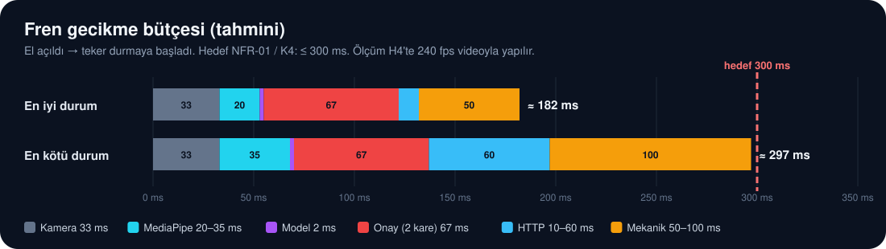</p>

En kötü durum hedefe çok yakın (~297 ms). Pay açmak için ilk bakılacak yerler: HTTP (aynı oda, `requests.Session`, gerekirse UDP · D8) ve MediaPipe (`MODEL_COMPLEXITY=0`).

---

## 16. Kayıt (Log) Formatı

Her sürüş `logs/drive_YYYYMMDD_HHMMSS.csv` dosyasına yazılır:

```text
t_ms,frame,fps,hand,label,conf,rule_ok,state,cmd_d,cmd_s,cmd_t,reason,sent,seq,http_ms,ok
0,1,29.8,1,fren,0.97,1,DURUYOR,0,0,N,init,1,1,18,1
...
```

Bu kayıttan rapor için şunlar üretilir: komut zaman çizelgesi, gaz/fren sayısı, ortalama HTTP gecikmesi, kopma anları, sınıf başına güven dağılımı. Kayıtlar Git'e girmez, rapora giren seçilmiş kayıtlar `reports/` klasörüne kopyalanır.

---

## 17. Yol Haritası (6 Hafta)

Kural: bir kapı geçilmeden sonraki aşamaya geçilmez. Her cuma 19:00 video + kayıt gruba atılır.

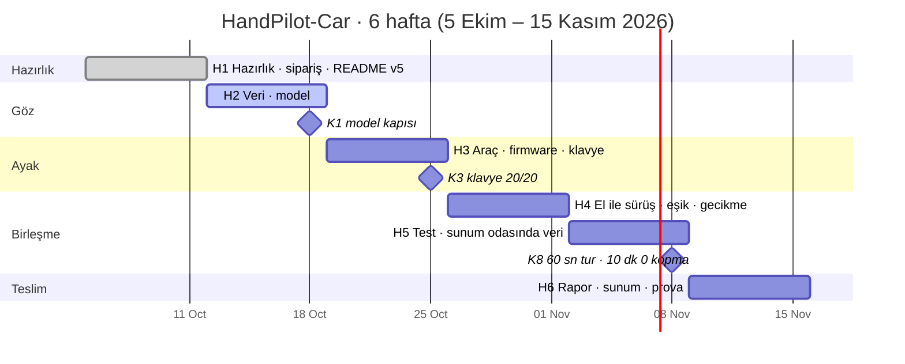

| Hafta | Tarih | Ad | Bitecekler | Cuma çıktısı |
|---|---|---|---|---|
| **H1** ✅ | 5–11 Eki | Hazırlık | Donanım araştırması + 13 kalem sipariş, `veri_topla.py`, Git/GitHub, README v5, hareket seti v5 | README v5, sipariş listesi, veri aracı |
| **H2** | 12–18 Eki | Göz | 8 kişinin verisi + rıza, `diger` çekimi, `DATASET.md` v1, `extract_landmarks` + `train` + `evaluate`, `controller` + testleri, `camera.py`; malzeme envanteri, şasi montajı, ESP32 ilk yükleme | Karışıklık matrisi (**K1**) |
| **H3** | 19–25 Eki | Ayak | Güç devresi + pertinaks, firmware, ölü bölge ölçümü, WiFi ping testi, `car_client`, `keyboard_drive`, `logger`, araçsız canlı tanıma | Klavyeyle slalom (**K2, K3, K7**) |
| **H4** | 26 Eki–1 Kas | Birleşme | `main.py`, `ui.py`, pist, eşik ayarı, 240 fps gecikme ölçümü, `vbat` göstergesi | El ile sürüş videosu (**K4–K6, K10**) |
| **H5** | 2–8 Kas | Test | Sunum odasında ek veri + model v2, 60 sn tur, 10 dk dayanıklılık, herkes 3 tur sürer, opsiyonel ekstralar, rapor taslağı | Tur videosu + log (**K8, K9, K11**) |
| **H6** | 9–15 Kas | Teslim | Final rapor (15–20 sayfa), 10 slayt, yedek video, 3 prova, final gecesi kontrol listesi | PDF + slayt + video + repo linki |

**Kritik yol:** H2'de K1 sağlanmadan el ile sürüşe (H4) geçilmez. H3'te klavyeyle 20/20 olmadan el eklenmez.

---

## 18. Ekip ve Sahiplik

| Kişi | Alan | Sahip olduğu dosyalar (öneri) |
|---|---|---|
| **Furkan Gül** | Yazılım: Lider + Birleştirme | `main.py`, `config.py`, `controller.py`, README, model sürüm onayı |
| Sibel Akardaş | Yazılım: Görüntü + Rapor | `landmarks.py`, `features.py`, veri seti protokolü, `DATASET.md`, `evaluate.py` |
| Sinem Bolat | Yazılım: Hareket + Test | `gesture.py`, `train_classifier.py`, `tests/` |
| Hazal Kanik | Yazılım: Ekran + Sunum | `ui.py`, `test_camera.py`, slaytlar |
| Reyyan Ceyda Can | Yazılım: Bağlantı + Kayıt | `car_client.py`, `logger.py`, `keyboard_drive.py` |
| Recep Özkan | Elektrik: Araç beyni | `firmware/`, pin planı |
| Sefa Eren Yalçın | Elektrik: Güç + Kablolama | Kablolama, güç, bağlantı şeması |
| Amadou Billy Sidibe | Elektrik: WiFi + Güvenlik | AP ayarları, WiFi testi, pist ve güvenlik |

**Veri toplama herkesin işidir:** 8 kişinin her biri `veri_topla.py` ile 1200 fotoğraf verir (20 dk çekim + molalar ≈ 35 dk).

---

## 19. Git ve Kod Kuralları

- `main` dalı korumalıdır. Değişiklik yalnızca Pull Request ile yapılır, Furkan onaylar.
- Dal adı: `h<hafta>-<isim>-<konu>` → `h2-sinem-gesture-rules`
- Commit: `h2-sinem: yön için açı kontrolü eklendi`
- Her PR: ne değişti, nasıl test edildi, `config` değiştiyse eski → yeni değer.
- Her dosyanın bir sahibi vardır (§18). Başkasının dosyasına PR açılabilir, doğrudan yazılmaz.
- **Git'e girmez:** `dataset/raw/`, `logs/`, `.venv/`, `__pycache__/`, `.DS_Store`, kişisel notlar.
- Stil: PEP 8, type hint, docstring'de kısa amaç. `ruff check .` temiz olmadan PR açılmaz.
- Ekrana yazılan metinlerde Türkçe karakter kullanma: `cv2.putText` ı, ş, ğ gibi harfleri `?` olarak basar. ASCII'ye çevir (veri toplama aracındaki `ascii_tr` gibi) ya da PIL ile çiz.

---

## 20. Sorun Giderme

| Belirti | Olası neden | Çözüm |
|---|---|---|
| Kamera açılmıyor | Zoom/Teams kamerayı tutuyor; macOS izni yok | Uygulamayı kapat; Gizlilik → Kamera izni; `--camera 1` dene |
| Ekranda `?` karakterleri | `cv2.putText` Türkçe çizemez | ASCII'ye çevir |
| El bulunmuyor | Işık az, ters ışık, el çok yakın/uzak | Lamba aç, pencereye sırtını verme, 50 cm |
| Sol/sağ ters | Aynalama toplama ile sürüşte farklı | `MIRROR` değerini ve `metadata.csv` içindeki `mirrored` sütununu karşılaştır |
| Yumruk "diğer" çıkıyor | Başparmak avucun içinde, model o şekli görmedi | Başparmağı üste al; o kişiden ek veri topla |
| Yön algılanmıyor | Başparmak kameraya/yukarı bakıyor ya da çok eğik | Başparmağı yatay ve yana uzat (±35°) |
| Yumruk yön sanılıyor | Gazda başparmak yana çıkmış | Başparmağı parmakların üstüne al |
| Komut titriyor | Işık az; eşik sınırda | Işığı artır; `FRAMES_*` +1; o koşulda ek veri |
| Model başlamıyor: "FEATURE_VERSION mismatch" | Model eski özellik tanımıyla eğitilmiş | Yeniden eğit |
| Araç 1 sn'de bir duruyor | Heartbeat gitmiyor | `car_client` thread'i çalışıyor mu, log'da `sent` sütunu |
| Bağlanmıyor / adres bulunamadı | Yanlış ağ, araç kapalı, IP yanlış | `HandPilot-Car` ağı, pil, `CAR_URL` |
| Motor titrer, gitmez | Pil < 4.4 V (yükte) ya da hız ölü bölgenin altında | Şarj et; `MIN_PWM` ölç |
| Motorlar hiç dönmüyor, ESP32 çalışıyor | TB6612 `STBY` LOW kalmış ya da VM'ye güç gelmiyor | Firmware'de STBY → HIGH; sigorta ve switch'i kontrol et |
| ESP32 gaz verince yeniden başlıyor | Motor yükünde pil voltajı düşüyor (brownout) | ESP32'yi powerbank'tan besle, 100 µF'ı kontrol et (§12.6) |
| Sigorta atıyor | Kısa devre ya da motor sıkışmış | Kabloları multimetreyle kontrol et, tekerleri serbest bırak |
| Teker ters dönüyor | Motor kabloları ters | O motorun iki kablosunu değiştir |
| ESP32 açılmıyor (kablolar takılıyken) | GPIO12 strapping | PWMB'yi GPIO13'e taşı |
| Açılışta motor seğiriyor | GPIO14 açılış PWM'i ya da STBY açılışta HIGH | PWMA'yı GPIO25'e taşı, STBY'yi WiFi'den önce LOW yap |
| `ledcSetup` derleme hatası | ESP32 çekirdeği 3.x | 2.0.x kur ya da §12.5'teki 3.x API'sini kullan |
| FPS düşük | Laptop pilde, yüksek çözünürlük | Şarja tak, 640×480, `MODEL_COMPLEXITY=0` |
| Program kapanınca araç gidiyor | Çıkışta `/stop` yok | `finally` bloğunu kontrol et (FR-12); watchdog yine 1 sn'de durdurur |
| Sunumda WiFi gitti | — | Yedek video (USB + telefon), güvenlik katmanlarını anlat |

---

## 21. Riskler ve Açık Kararlar

### 21.1 Riskler

| Risk | Olasılık | Etki | Önlem |
|---|---|---|---|
| Sunum odasının ışığı farklı | Yüksek | Yüksek | H4'te o odada ek veri + yeniden eğitim, ek lamba |
| Veri seti dengesiz / az kişi | Orta | Yüksek | §9.5 kontrol listesi, kişi bazlı CV |
| MediaPipe sürüm değişikliği | Orta | Orta | `requirements.txt` sürüm kilidi, sunum laptopu son 2 hafta sabit |
| Pil sunumda biter | Orta | Yüksek | Yedek 4'lü pil, `/status` içindeki `vbat`, eşik altında değişim |
| 4×AA motor yükünde çöker, ESP32 yeniden başlar | Orta | Yüksek | ESP32 powerbank'tan ya da 5 V yükselticiden beslenir; 100 µF + 100 nF |
| Malzeme geç gelir / arızalı çıkar | Orta | Orta | H2 başında envanter, arızalı parça aynı hafta yeniden sipariş |
| Tek kişi sürebiliyor | Orta | Yüksek | Herkes 3 tur sürer (H4) |
| WiFi paraziti | Düşük | Yüksek | Watchdog, yedek video |

### 21.2 Açık kararlar (H1 cuma toplantısında kapatılır)

| # | Karar | Öneri |
|---|---|---|
| D1 | Hareket seti v5'in kabulü (EL_KITABI → V5 güncellemesi) | Kabul; eski `assets/02_el_bolgeleri.svg`, `03_durum_makinesi.svg`, `v3_02_el_haritasi.svg` **geçersiz** sayılır |
| D2 | Pin değişikliği (PWMA 14→25, PWMB 12→13) + TB6612 için STBY = GPIO23 | Kabul |
| D3 | Gaz gecikme hedefi 400 ms (frenden ayrı) | Kabul |
| D4 | Duruyorken ⬅️/➡️ ile yerinde dönüş | Şimdilik yok (güvenlik); zaman kalırsa yavaş pivot |
| D5 | Hız ekstrası (yumruk yüksekliği → 140/180/220) | Opsiyonel; mandal mantığıyla uyumlu |
| D6 | v4 "çift yumruk korna" ekstrası | **İptal**: tek el kuralıyla çelişiyor. Yerine klavyede `H` tuşu |
| D7 | v4 "sol el yukarı = geri vites" | **İptal** (iki el). Gelecek çalışma |
| D8 | HTTP → UDP | Yalnızca ölçülen ağ gecikmesi > 80 ms ise |
| D9 | Pil göstergesi, engel freni, sürüş kaydı, sesli onay | Pil göstergesi önerilir (`/status`); sürüş kaydı zaten §16'da var |

---

## 22. Sözlük

| Terim | Anlamı |
|---|---|
| **Landmark (el noktası)** | MediaPipe'ın elde bulduğu 21 noktadan biri (0 = bilek, 4/8/12/16/20 = parmak uçları) |
| **Özellik vektörü** | Normalize edilmiş noktalardan oluşan sayı listesi (modelin girdisi) |
| **Sınıf** | Modelin seçtiği etiket: `gaz`, `fren`, `sol`, `sag`, `diger` |
| **Güven** | Modelin seçtiği sınıfa verdiği olasılık (0–1) |
| **Onay (debounce)** | Komutun kabul edilmesi için aynı sınıfın ardışık N karede görülmesi |
| **Mandal (latch)** | Gazın yumruk bırakılsa da açık el gelene kadar sürmesi |
| **Heartbeat** | Aynı komutun düzenli aralıkla tekrar gönderilmesi ("hâlâ buradayım") |
| **Watchdog** | Komut kesilince aracın kendi kendine durması (1 sn) |
| **Ölü bölge** | Motorun dönmeye başlamadığı düşük PWM aralığı (~120 altı) |
| **PWM** | Motora giden gücün 0–255 arası ayarı |
| **TB6612FNG** | İki DC motoru süren MOSFET tabanlı sürücü kartı (L298N'nin yerine) |
| **STBY** | TB6612'nin bekleme pini: LOW iken motorlar kesin kapalı |
| **Brownout** | Voltaj düşünce ESP32'nin kendini yeniden başlatması |
| **AP (Access Point)** | ESP32'nin açtığı WiFi ağı |
| **Strapping pin** | ESP32'nin açılışta durumuna baktığı özel pin (12, 0, 2, 15, 5) |
| **Leave-one-person-out** | Her seferinde bir kişiyi test için ayırıp kalanlarla eğitme |
| **Karışıklık matrisi** | Hangi sınıfın hangisiyle karıştırıldığını gösteren tablo |

---

## 23. Değişiklik Geçmişi

| Sürüm | Tarih | Değişiklik |
|---|---|---|
| v4 | 2026-10-04 | `EL_KITABI.md`: konum tabanlı yön, y-koordinatlı parmak kuralı, 5 haftalık plan |
| v5 | 2026-10-10 | **README oluşturuldu (mihenk taşı).** Hareket seti v5 (✊ mandallı gaz, ✋ fren, 👈👉 işaret parmağı ile yön); kendi veri setimiz + nokta tabanlı sınıflandırıcı; asimetrik onay; heartbeat (v4 watchdog çelişkisi giderildi); arka plan gönderici; `seq` alanı; pin önerisi (GPIO12/14); güvenlik katmanları; KVKK; `tools/collect_dataset.py` |
| **v5.1** | **2026-10-11** | Yön hareketi değişti: ⬅️ / ➡️ artık **yumruk + başparmak sola/sağa** (işaret parmağı yerine). Bütün hareketler **yalnızca sağ elle**. Gaz kuralına "başparmak açık değil" eklendi, yön kuralı başparmak açısına (nokta 2 → 4) taşındı. `veri_topla.py`: yeni ipuçları, "SADECE SAĞ EL" uyarısı, `S` ile her ekranda sıradaki harekete geçme. |

| **v5.2** | **2026-10-13** | **Görsel README:** banner, hareket kartları, 21 nokta diyagramı, prototip ve bağlantı şeması çizimleri, arayüz taslakları, istatistik grafikleri (`docs/assets/`). Donanım **TB6612FNG + 4×AA Ni-MH**'ye güncellendi (§12, pil eşikleri, sorun giderme, riskler). Yol haritası **6 haftaya** çıkarıldı (§17). Şablonlar (§25) ve **MIT lisansı** (§26) eklendi. Kilitli (🔒) maddelerde değişiklik yok. |

---

## 24. Sayılarla HandPilot-Car

> Aşağıdakiler **plan ve hedef** sayılarıdır. Ölçülen değerler geldikçe (H2–H5) "Ölçülen" sütunu doldurulur.

| Alan | Sayı | Ölçülen |
|---|---|---|
| Ekip | 8 kişi (5 yazılım, 3 elektrik) | — |
| Süre | 6 hafta, 3 kapı (K1, K3, K8) | — |
| Hareket sınıfı | 4 komut + `diger` | — |
| El noktası / özellik | 21 nokta → 63+ özellik | — |
| Veri seti hedefi | 9 600 kare (+ 2 400 `diger`) | |
| Kişi başı çekim | 1 200 kare, ≈ 35 dk | |
| Fonksiyonel / fonksiyonel olmayan gereksinim | 20 / 12 | — |
| Kabul kriteri | 11 (K1–K11) | |
| Güvenlik katmanı | 8 | — |
| Laptop modülü | 10 (`config` … `main`) | — |
| Sipariş edilen malzeme | 13 kalem | — |
| Fren onayı / gaz onayı | 2 kare (~67 ms) / 5 kare (~167 ms) | |
| Fren gecikmesi hedefi | ≤ 300 ms (tahmini bütçe 182–297 ms) | |
| Döngü hızı hedefi | ≥ 20 fps | |
| Watchdog | 1 sn | |
| Heartbeat | 300 ms (watchdog'un ~3 katı sıklıkta) | — |

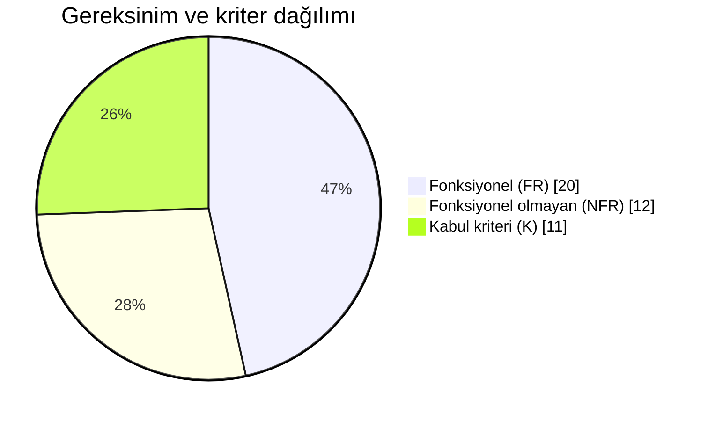

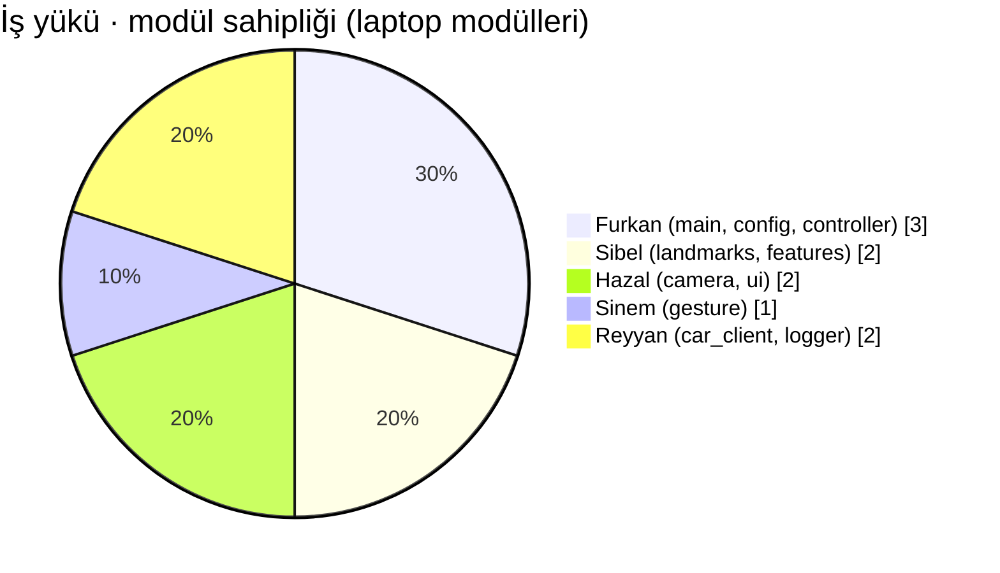

---

## 25. Şablonlar

| Şablon | Yer | Ne zaman |
|---|---|---|
| Pull Request | [`.github/PULL_REQUEST_TEMPLATE.md`](.github/PULL_REQUEST_TEMPLATE.md) | Her PR'da otomatik açılır |
| Hata bildirimi | [`.github/ISSUE_TEMPLATE/hata_bildirimi.md`](.github/ISSUE_TEMPLATE/hata_bildirimi.md) | Yanlış tanıma, durmayan araç, çökme |
| Görev kartı | [`.github/ISSUE_TEMPLATE/gorev.md`](.github/ISSUE_TEMPLATE/gorev.md) | §17'deki her iş için |
| Veri seti kartı | [`docs/templates/DATASET.md`](docs/templates/DATASET.md) | Her eğitimden önce → `dataset/DATASET.md` |
| Haftalık rapor | [`docs/templates/HAFTALIK_RAPOR.md`](docs/templates/HAFTALIK_RAPOR.md) | Her cuma |
| Kabul testi kaydı | [`docs/templates/TEST_KAYDI.md`](docs/templates/TEST_KAYDI.md) | K1–K11 ölçümlerinde |
| Açık rıza formu | [`docs/templates/RIZA_FORMU.md`](docs/templates/RIZA_FORMU.md) | Veri vermeden önce, her katılımcı (imzalı form repoya **girmez**) |

**Görselleri güncellemek:** `docs/assets/*.svg` düz metin SVG dosyalarıdır; herhangi bir editörde (VS Code, Inkscape, Figma) açılıp düzenlenebilir. Gerçek fotoğraflar `docs/assets/foto_*.jpg` adıyla eklenir, yüz görünen fotoğraf eklenmez.

---

## 26. Lisans

Bu projenin **kaynak kodu ve belgeleri** [MIT Lisansı](LICENSE) ile lisanslanmıştır. © 2026 Furkan Gül ve HandPilot-Car ekibi.

> [!IMPORTANT]
> **Veri seti lisansa dahil değildir.** Katılımcı fotoğrafları kişisel veridir (KVKK, §9.7): yalnızca bu ders projesi için, açık rızayla toplanır, repoya girmez ve paylaşılmaz. `landmarks.csv` gibi yüz içermeyen türetilmiş veriler repoda olsa bile katılımcıların rızası dışındaki amaçlar için kullanılamaz.

Kullanılan açık kaynak bileşenler kendi lisanslarına tabidir: OpenCV (Apache 2.0), MediaPipe (Apache 2.0), scikit-learn (BSD-3), NumPy (BSD-3), Requests (Apache 2.0), Arduino-ESP32 çekirdeği (LGPL 2.1).

<div align="center">

*Anlamadığın bölümü numarasıyla gruba sor (ör. "§3.2 neden fren 2 kare?").*

</div>
